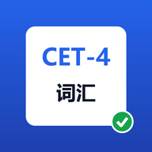

<div align="center">

# noadic

**Not only a dictionary — 不止词典。**

一台跑在浏览器里、能封成 Android App 的**词汇学习引擎**：
录入 → 按书顺序学 → 遮罩背诵 → 五题型考核 → 错题闭环 → 写作阅读联动。
零构建、零依赖、零服务器，数据全在你自己设备上。

[](https://github.com/yjy1122/noadic/actions/workflows/android.yml)
[](https://github.com/yjy1122/noadic/releases/latest)
[](https://github.com/yjy1122/noadic/releases/download/latest-debug/app-debug.apk)
[](_tools/test-logic.mjs)
[](_tools/device-smoke.mjs)
[](CHANGELOG.md)

[](LICENSE)


</div>

---

## ✨ 核心特性

### 📷 拍照识词与智能提取

把 AI 拍照提取出来的**原始文本**直接粘进来，解析器按真实教材的脏形状逐行归一：Markdown 表格、Tab 两列、`单词：释义`、`单词 — 释义`、内联音标 `realm /relm/`、中文词性 `名词，领域` → `n. 领域`、行首序号、行尾页码、被折成两行的词条、`例：…` 行内例句自动拆成中英双语例句。也支持直接拖入 `.docx`（**浏览器内解压**，不上传任何文件）。

识别照片走**视觉模型**（不是本地 OCR）：配好支持视觉的 OpenAI 兼容端点后，选图即提取；没网或没 key 时自动退化为「复制粘贴桥」——本地生成契约 Prompt，贴给任意大模型，回复粘回来自动剥掉 ` ```json ` 围栏并进同一张入库预览表。

### 💬 对话式生词收集

`把 postpone 加进生词本`、`「undertake」这个词帮我记一下` —— 本地意图提取，**零网络**，只收中文环境里隔离出现的英文词，不会逐词吞掉整句英文，并过滤 `a/the/is/at` 等极简词（但保留其作为核心短语一部分的情况）。

### 🗂 两级词库：Unit → Lesson

按教材真实结构组织，不是扁平一张表。外层单元卡、内层课次卡，各自带进度条、`掌握/错题/学习中/待测/缺补全` 分色计数与动作。归属以**主单元**为准，跨册再遇到同一个词时在词条上标 `也见于 Unit 9`，**不会**重复计数，也不会因此重置进度。

### 📖 遮罩背诵（纯记忆模式）

刷题之前先要**把词过一遍**。背诵页就是你贴进来的那张两列表（英文单词 / 词性及中文释义），整页扫读，不出题、不判分、不计入正确率：

- **三档遮罩**：`遮中文`（看词想义）/ `遮英文`（看义想词，默背拼写）/ `不遮`（通读）。点被遮住的格子显示，再点遮回；也有「显示全部 / 全部遮回」整页开关。
  遮罩用 `visibility: hidden` 实现，被遮的文字会**从可访问性树里整个消失** —— 所以读屏器、朗读、复制选区都不会剧透答案（真机断言 D16 就是查这一点，而不是"看起来像遮住了"）。
- **标记背不熟**（行尾 ☆/★）：与错题本是**两条独立的轴** —— 错题由测验自动判定，不熟由你手动认定。标记不碰 `status`，也不占用「撤销上次改动」的快照槽（非破坏性操作不该吃掉撤销历史）。
- **按书选组**：单元 / 课次下拉，可只看「不熟」或「没标记的」，可乱序（记住的是词，不是位置；乱序结果按当前这组词缓存，标一个词不会让整页重排）。
- **闭环**：「标了不熟的词 → 去测验只练这些」，测验范围条同步有「只练不熟」，走同一套出题调度 —— 加权、冷却、错题强制换题型**规则一律不变**。
- 标了不熟、但测验里已用 2 种题型答对的词，星号**变绿**并在计数条提示"可以摘了"，但绝不自动替你摘。

标记在四处联动可见：背诵页计数、词库行上的 `不熟` 标签、词库状态筛选的「背不熟」选项、删除确认框里的「其中 N 个标了背不熟」。

### 🎯 多维度刷题考核

| 题型 | 考点 | 前置条件 |
| --- | --- | --- |
| 四选一 · 英译中 | 干扰项必须**形近 / 义近 / 同词性 / 同词根**，不出无关干扰项 | 词库+扩展池 ≥3 个相关词 |
| 四选一 · 中译英 | 反向，同上 | 有中文释义 |
| 语境填空 | 用例句挖空，**考词形变换**（写原形判错并提示正确形式） | 有英文例句 |
| 熟词生义 | 有语境句走语境题，否则问「它还有哪个含义」 | 有 ≥2 个义项 |
| 听音拼写 | 只给 IPA + 中文提示（可 🔊 朗读），接受异形拼写 | 有音标 |

除「混合轮换」外，每种题型都有**专项模式**（按钮上实时显示当前词库能出该型的词数），适合单点突破。

### 🔄 科学动态错题本

答错 → **立即入错题本并记混淆原因**（误选项与目标词的混淆类型 / 拼写差几个字母 / 词形未变换）→ 该词的已答对题型清零 → 后续按**冷却 + 配额 + 轮转**高频复现，且**强制更换题型** → 在 **2 种不同题型**上答对才算掌握，之后以低概率回炉抽查。

> 错题优先级做过防「磁吸效应」处理：早期版本错题会吃掉整轮题目、书序永远不前进，现在复习配额（默认 70%）与冷却轮转共同约束它。

### 📈 四级全科拓展（Mode 3）

- **写作微练习**：抽 3 个错词 → 写微段落 → **离线规则批改**（是否用上、字数、逗号拼接句、`very/many/think/more and more/because of` 的高分替换建议 + 分数）；配好端点可切 AI 精批。
- **阅读联动**：按你的难词库**离线拼装** 150–200 词短文 + 生词表 + 最长句的长难句分层拆解。

### 🧹 重复录入治理

去重是这个项目的一等公民（同一本书拍照时会反复出现同一个词）：归一化别名（`despatch/dispatch`、`so-called`↔`so called`）、**英美异形作为「软别名」**只用于查重、绝不污染词条拼写（所以 `pour` 永不会被生成假词 `por`）、**不反向猜词元**而是对库内已有词生成屈折变形表来匹配新词（`assumes → assume`、`ground → grind`）。预览是 dry-run，逐行标注 `新增/合并/重复忽略`，**导入永不重置学习进度**。

### 📱 离线优先，随处可用

白色主题、底部导航、设置以底部面板呈现，按手机 App 的形态设计。`localStorage` 存储 + PWA/Service Worker + Capacitor 封装成 APK。**AI 是可插拔增强开关**：不配 key 时全部功能可用（内置 129 条离线词典 + 30 条易混词池），配了 key 才走网络。

---

## 📸 界面预览

<div align="center">

</div>

> 上面是**真实图标**（由 `_tools/make-icons.py` 用 Pillow 生成）。界面截图待补 —— 本项目没有 UI 框架，截图无法从代码生成，需要真机/浏览器采集：
>
> ```
> docs/screenshots/quiz.png        测验页：题卡 + 五段反馈
> docs/screenshots/library.png     词库页：Unit → Lesson 两级分组与进度条
> docs/screenshots/sequence.png    顺序闯关步骤条（✓ 已通关 / ▶ 进行中 / 🔒 未开始）
> docs/screenshots/ingest.png      录入页：解析预览表与「归属」列
> docs/screenshots/android.jpg     手机端实机（含底部导航）
> ```
>
> 有截图愿意提 PR 的，直接按上面路径放进 `docs/screenshots/` 即可。

---

## 🛠 技术栈

| 层 | 选型 | 说明 |
| --- | --- | --- |
| 前端 | **原生 HTML / CSS / ES2020** | 无框架、无打包器、无 `node_modules` 依赖，浏览器直开 |
| 状态与存储 | `localStorage` + 双索引 | 别名索引 + 屈折面索引；单槽撤销快照 |
| 语音 | Web Speech API | 🔊 朗读，`file://` 下受限 |
| 文档解析 | `DecompressionStream('deflate-raw')` | 浏览器内解 `.docx`，不上传 |
| 移动壳 | **Capacitor 6**（`@capacitor/cli/core/android`） | 唯一需要 Node 的环节，仅用于打包 |
| 云构建 | **GitHub Actions** + `setup-java` / `setup-android` | push 即出 debug APK 并发布到 Release |
| AI（可选） | 任意 **OpenAI 兼容**端点（含视觉模型）/ 复制粘贴桥 / 本地意图提取 | 三条通道，契约恒定；Key 只存本机 |
| 质量 | Node `vm` 沙箱跑浏览器模块 + adb 驱动真机 | 249 项逻辑测试 + 26 条真机断言 + 静态接线审计 + 跨模块引用对账 |

**没有后端。** 全部逻辑与数据都在客户端；AI 调用是你主动配置的可选增强。

---

## 🚀 快速开始

### 环境要求

- **只想用**：一个现代浏览器（Chrome / Edge / Safari）。不需要 Node、不需要 npm。
- **想改代码**：Node ≥ 18（跑回归测试与打包脚本）。
- **想本机出 APK**：JDK 17 + Android SDK（或用 `_tools/toolchain-and-build.ps1` 一键装到项目内，不写系统、不要管理员）。

### 安装与运行

```bash
git clone https://github.com/yjy1122/noadic.git
cd noadic
```

**方式 A — 零安装**：双击 `www/index.html`。首次打开自动载入 127 个种子词。

**方式 B — 要发音与 PWA**（Service Worker 需要 http(s)）：

```bash
python -m http.server 8080 -d www      # 或任意静态服务器
# 打开 http://localhost:8080/ ，可「添加到主屏幕」离线使用
```

**方式 C — 直接装 APK**（不用登录，公开库直链）：

```
https://github.com/yjy1122/noadic/releases/download/latest-debug/app-debug.apk
```

`latest-debug` 每次 push 自动更新；正式版本看 [Releases](https://github.com/yjy1122/noadic/releases)。装法：传到手机 → 点击安装 → 允许「安装未知来源应用」。

### 配置 AI 增强（可选）

**没有 `.env`，没有配置文件** —— 全部在应用内「⚙ 设置 → AI 端点」填写，只存本机 `localStorage`：

| 字段 | 说明 |
| --- | --- |
| Base URL | 填到 `/v1` 为止，例如 `https://api.openai.com/v1`；本地 Ollama 之类填 `http://localhost:11434/v1` |
| Model | 模型名；拍照识别需**支持视觉**的模型 |
| API Key | 仅存本机，不上传任何服务器 |

填完点 **🔌 测试连接**，它返回**分类结论**而不是笼统的「失败」：`连通 ✅（123ms，发现 5 个模型；生成通道也通了）` / `能取到模型列表，但生成通道不通` / `鉴权失败（401）` / `404：Base URL 路径不对` / `429：限流或额度不足` / `请求没能发出：多为 CORS 拦截`（此时改用复制粘贴桥）/ `还没填 Base URL`。

> **探测会真打一次生成通道。** 早期版本只看 `GET /models`，于是"连通 ✅"能骗人 —— DeepSeek 就是活例子：`/models` 秒回 200，而 chat 被跨域拦死。现在取到列表后还要发一次 `max_tokens:1` 的最小 chat（自带 ≤25 秒上限，否则探测自己会被"200 + keep-alive 永不返回"挂死），**两者都过才算通过**。
>
> **云端 API（含 DeepSeek / OpenAI）通常不放行浏览器跨域，所以在本 App 里直连必然失败** —— 请改用**复制粘贴桥**（离线可用，契约一致）。要直连就得有个允许跨域的入口：本地 Ollama / LM Studio，或自己架一层带 CORS 头的转发。本地 `http://` 端点所需的明文流量许可已由构建脚本自动写入 `AndroidManifest.xml`（Android 9+ 默认禁明文，只开 `allowMixedContent` 仍然连不上）。

> **不配 key 会损失什么？** 只损失「AI 补全音标/例句/搭配」和「拍照识别」。去重、出题、判卷、错题闭环、顺序闯关、写作阅读联动全部照常工作 —— 它们不依赖网络。

### 构建 APK

三条路线（详见 [`BUILD-APK.md`](BUILD-APK.md)）：

1. **云构建（推荐，本机零安装）**：`git push` → Actions 自动出包并发布到 Release。
2. **本机一键**：`powershell -ExecutionPolicy Bypass -File _tools\toolchain-and-build.ps1`（7 步幂等，工具链装进 `.tooling\`）。
3. **已有 JDK/SDK**：`npm install && npx cap add android && npx cap sync && cd android && gradlew.bat assembleDebug`。

### 开发自检

```bash
node _tools/test-logic.mjs            # 249 项端到端逻辑测试（在 Node vm 里把浏览器模块当无头环境跑）
node _tools/audit-wiring.mjs          # JS 语法 + 全部 #id 选择器对账
node _tools/xref.mjs                  # 跨模块引用对账（抓"开机即抛"的名字错）
powershell -ExecutionPolicy Bypass -File _tools\check-workflow.ps1 -SelfTest
                                      # 校验 CI 配置；-SelfTest 故意破坏它 6 种，验证这条检查真有牙
bash _tools/notes-extract.sh          # 发布说明抽取自检：三个版本都要抽到，不存在的版本必须抽不到
node _tools/device-smoke.mjs --shots  # 装了模拟器/真机时：26 条端到端断言，全程真实点击
                                      # （--selftest 是同一条负向对照）
```

---

## 📋 更新日志

完整历史在 **[CHANGELOG.md](CHANGELOG.md)**，按 [Keep a Changelog](https://keepachangelog.com/zh-CN/1.1.0/) 格式记录。

**那份文件是发布说明的唯一真源**：CI 出正式版本时，会从 `CHANGELOG.md` 里抽出对应版本那一段，直接作为 GitHub Release 的正文（`_tools/notes-extract.sh` 会校验这段抽取，含"不存在的版本必须抽不到东西"的负向对照）。所以 Release 页上的字和仓库里的字不会各说各话 —— 这里没写的，Release 上也不会出现。

---

## 🗺 路线图

### 已完成

- [x] Mode 1 录入契约：粘贴 / `.docx` 浏览器内解析 / `.csv` / `.json`，脏形状归一
- [x] 去重四情形与进度保护、dry-run 预览、单槽撤销
- [x] 内置离线词典包（129 条英式 IPA + 搭配 + 例句，30 条易混/熟词生义池）
- [x] 五题型出题与判卷、形近/义近/同词性/同词根干扰项引擎
- [x] 错题闭环：错因记录、冷却+配额+轮转、强制换题型、2 种不同题型答对才掌握
- [x] Unit → Lesson 两级词库；按课次块顺序闯关（达标线可调、锁定不回摆、回潮标记）
- [x] 题型专项模式（混合轮换 + 五个单型）
- [x] Mode 3：写作微段落离线批改 + 150–200 词定制短文 + 长难句分层拆解
- [x] 触屏滑动切题、键盘作答、自动连答、紧凑题头 + 可展开设置面板
- [x] 三种粒度删除（单词 / 整课 / 整单元）+ 报数确认 + 撤销连带恢复通关锁定
- [x] 遮罩背诵页：三档遮罩 + 手动「背不熟」标记 + 只练不熟闭环
- [x] AI 连通性自检与失败分类
- [x] 浅色 App 化界面、PWA、Capacitor APK、Actions 云构建 + Release 自动发布
- [x] 真机端到端测试（adb + 无障碍树按文字定位，对旋转/分辨率免疫）与负向对照
- [x] 249 项回归测试与四道静态审计

### 计划中

- [ ] 不同分辨率 / 低端机上的布局回归（真机测试目前固定在 1080×1920 @280dpi 一档）
- [ ] 横屏适配或锁竖屏（现在跟系统转，横过来会被拉得很宽）
- [ ] 截图与演示 GIF 补齐（见上方占位）
- [ ] 作文批改维度对齐真题评分档（目前为离线规则 + 可选 AI 精批）
- [ ] 语法填空 / 翻译真题专项题型
- [ ] 多词表包迁移（考研 / 雅思 / 自定义书表），复用同一套去重与闯关内核
- [ ] 端到端加密的可选云同步（默认仍然纯本地）
- [ ] iOS 打包路线（`cap add ios` 需要 macOS + Xcode）

---

## 📄 开源协议

[MIT © 2026 yjy1122](LICENSE)

选 MIT 是因为这类个人学习工具的价值在于**被人拿去改成适合自己那本书的词表**：随便用、随便改、随便商用，保留版权声明即可。

---

## 数据与隐私

- 词库、学习进度、错题本、背诵的「背不熟」标记、设置、API Key 全部存在**你设备的 `localStorage`**（键 `noadic.v1` / `noadic.undo`），本仓库不含任何账号或遥测代码。
- 唯一的出网请求是你主动配置的 AI 调用；不配置则整个应用零网络。
- 换设备：设置 → 导出 JSON；导入走同一套合并去重，**不会**冲掉进度。改名前（`CET-4 词汇引擎`）导出的备份文件仍然能直接导入。

## 目录结构

```
noadic/
├── www/                        ← 唯一 web 根（Capacitor 的 webDir）
│   ├── index.html              应用外壳（6 视图 + 底部导航 + 设置面板 + 编辑弹窗）
│   ├── css/app.css             浅色主题、底部导航、安全区、手机端底部面板
│   ├── manifest.webmanifest    PWA 清单
│   ├── sw.js                   Service Worker（http(s) 下注册，原生壳里自动跳过）
│   └── js/
│       ├── seed-words.js       样例教材解析出的 127 词
│       ├── lexicon.js          归一 / 别名 / 屈折 / 去重合并 ← 去重唯一真源
│       ├── dict-extra.js       离线词典包与易混池
│       ├── store.js            存储 + 双索引 + 撤销快照 + 层级统计与批量删除 + 背不熟标记
│       ├── parse.js            录入通道（粘贴 / docx / csv / json）
│       ├── distractors.js      干扰项引擎
│       ├── quiz.js             出题调度、五题型、判卷、错题状态机、Mode 3
│       ├── ai.js               Mode 1 三通道 + 连通性分类 + 写作批改
│       ├── ui.js               渲染层（含背诵页的遮罩与就地计数更新）
│       └── app.js              装配与事件流
├── assets/                     APK 图标与开屏图源图（1024 / 2732）
├── .github/workflows/android.yml   云构建 + 发布 Release（正文取自 CHANGELOG.md）
├── _tools/                     测试、审计、图标生成、工具链安装、编码规范化
├── CHANGELOG.md                更新日志 ← 发布说明的唯一真源
├── BUILD-APK.md                三条打包路线
└── HOWTO-git.md                Git 接入与本机网络/路径的坑（实测记录）
```

## 已知边界

- `file://` 下 Service Worker 不注册、剪贴板 API 可能需手动复制；要 PWA 请用 http(s)。
- 背诵页的遮罩是**视觉隐藏**（`visibility:hidden`，同时从可访问性树消失），内容仍在这页 DOM 里：复制、审查元素都拿得到。考自己刚好，防别人偷看不够。
- 「背不熟」是单值标记，没有"有点熟/很不熟"的程度分级；它也不参与通关判定 —— 顺序闯关的门只由测验成绩决定。
- 撤销只有一层：先批量删除、再导入一次，就撤不回那个删除了。
- 你自己导入的新词若不在内置词典里，音标/例句为空 → 语境填空与听写题会**跳过**这些词，直到用 AI 或手动补全（词库可按「缺音标/例句」筛选，单元卡上有一键补全）。
- 阅读短文是**离线拼装**：句子原样取自你的例句库，长度稳定落在 150–200 词，但**主题不连贯** —— 它练的是「在语境里认词」，不是篇章阅读。要连贯成文请配 AI 端点。
- 扩展易混池（30 词）的作答进度只保留在本次会话内，它不入词库。
- APK 是 **debug 签名**，仅供自用与安装测试，不要上架商店。
